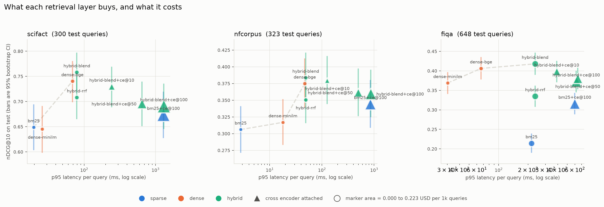
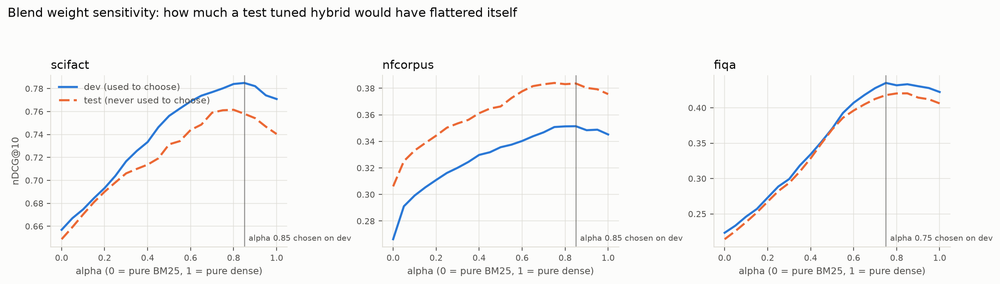

# retrieval-ablation

**On fiqa, blending BM25 with a bge-base bi-encoder reaches nDCG@10 of
0.418, up 0.204 points on BM25
(95% CI [+0.182, +0.227]),
at 1.1x the p95 latency and
0.0414 USD per 1000 queries. Adding a cross encoder over the
top 100 does not buy a single point on any of the three datasets: it makes the
ranking measurably worse on all three, at 2.6x the
p95 latency and 3.6x the cost on fiqa.** The layer
everybody adds last is the layer that should not be added at all here, and the
reason is visible in Recall@100: the first stage already returns
0.739 of the relevant documents on fiqa and only
0.347 on nfcorpus, so a reranker on nfcorpus
is reordering a candidate set that is missing two thirds of the answers.



## What this is

An ablation of a retrieval stack across three BEIR datasets, measuring what
BM25, dense retrieval, hybrid fusion and cross encoder reranking each
contribute in nDCG@10, against measured p95 latency and modelled cost per 1000
queries, with paired bootstrap intervals on every comparison and a hand built
taxonomy of the queries the best stack still fails.

Every number below is regenerated by `make analysis` from cached artifacts, and
this README is rendered from `README.template.md`, where each number is a lookup
into the generated JSON. A number that cannot be reproduced cannot be written
down here.

## What to actually build

1. **Start with a bi-encoder, not BM25.** On fiqa even the small 22M parameter
   MiniLM model reaches nDCG@10 0.369 against BM25's
   0.214, at 30 ms p95 against
   BM25's 216 ms, for 0.0032 USD per
   1000 queries against 0.0346. It is better *and* faster
   *and* cheaper: on that dataset BM25 is not on the Pareto frontier at all.
   (The BM25 here is pure Python and a Lucene implementation would close the
   latency gap, but not the quality one.)
2. **Blend, do not rank fuse.** The tuned score blend beats reciprocal rank
   fusion by 0.050, 0.033
   and 0.083 points on scifact, nfcorpus and fiqa, all
   three distinguishable from noise. RRF's freedom from a tuning parameter is
   not free.
3. **Pay for the bigger encoder.** bge-base over MiniLM is worth
   0.095 / 0.058 /
   0.038 points, distinguishable everywhere, for
   about 2x the query encoding time and 2x the index on disk.
4. **Do not attach a cross encoder to a good first stage.** See below. This is
   the expensive layer, and here it is a regression.

## The case where the expensive system is not worth it

This is the headline result, so it gets its own section.

The cross encoder (`ms-marco-MiniLM-L-6-v2`) reranking the top k of the best
first stage **loses** ground on every dataset:

| dataset | best first stage nDCG@10 | + cross encoder k=10 | + cross encoder k=100 | p95 cost of k=100 |
|---|---|---|---|---|
| scifact | 0.7580 | +0.0285 [+0.0070, +0.0502] | +0.0673 [+0.0384, +0.0961] | 16.6x |
| nfcorpus | 0.3836 | +0.0041 [-0.0036, +0.0126] | +0.0241 [+0.0099, +0.0390] | 17.6x |
| fiqa | 0.4179 | +0.0198 [+0.0085, +0.0311] | +0.0452 [+0.0284, +0.0619] | 2.6x |

Signs are stated as *first stage minus reranked*, so a positive number means the
reranker made it worse. Five of the six intervals exclude zero. The one that
does not is nfcorpus at k=10, where the reranker is indistinguishable from doing
nothing, which is the best outcome the cross encoder achieves anywhere in this
repo.

**This is not the reranker being broken.** Put the same model on top of BM25
instead and it earns its keep: +0.1014
[+0.0824, +0.1210]
on fiqa and +0.0381
[+0.0246, +0.0523]
on nfcorpus, both distinguishable from noise. On scifact it is
+0.0248
[-0.0052, +0.0554],
which spans zero and is therefore not a gain this evidence can claim.

So the reranker is not weak in general. It is simply *worse than the first stage it is asked to
improve*. It drags a bge quality ranking back down toward its own quality, and
the more documents you give it, the further down it drags: k=100 is worse than
k=50 is worse than k=10, monotonically, on all three datasets.

The engineering lesson is that a reranker's value is not a property of the
reranker. It is the gap between the reranker and the first stage under it. A
2019 era MS MARCO cross encoder sitting on a 2023 era bi-encoder is a downgrade
that costs 17.6x to 2.6x
the p95 latency to install.

## Recall@100 is the number that decides whether a reranker can help

A reranker can only reorder what the first stage handed it, so first stage
Recall@100 is a hard ceiling on any k=100 reranked system.

| dataset | BM25 Recall@100 | best first stage Recall@100 | what a perfect reranker could reach |
|---|---|---|---|
| scifact | 0.8764 | 0.9667 | 0.9667 |
| nfcorpus | 0.2439 | 0.3475 | 0.3475 |
| fiqa | 0.4573 | 0.7385 | 0.7385 |

nfcorpus is the instructive one, and it is worth being careful about *why* its
ceiling is low, because the obvious explanation is wrong. nfcorpus judges about
38.19 documents relevant per
query on average, which invites the conclusion that 100 slots simply cannot hold
them. They can. The median query has far fewer, and only
22 of
323 nfcorpus queries have more than 100 positives,
so the cutoff alone caps Recall@100 at
0.9647, not at
0.3475.

The gap between those two numbers is the real finding: nearly all of nfcorpus's
missing recall is the retriever genuinely failing to find judged documents, not
an artifact of the cutoff. So on nfcorpus the intervention that would pay is a
better or deeper *first stage*, not a reranker, and not merely a larger k. A
reranker at k=100 there is polishing a candidate set that is missing about two
thirds of the answers for reasons no amount of reordering can reach.

For comparison, the cutoff caps Recall@100 at
1.0000 on scifact and
1.0000 on fiqa, so on those two
datasets the cutoff is not binding at all and Recall@100 is a clean measure of
first stage quality.

## Datasets

| dataset | split | docs | queries | positives/query | label density | grades |
|---|---|---|---|---|---|---|
| scifact | dev (`train`) | 5,183 | 809 | 1.14 | 0.0219% | 1:919 |
| scifact | test (`test`) | 5,183 | 300 | 1.13 | 0.0218% | 1:339 |
| nfcorpus | dev (`dev`) | 3,633 | 324 | 35.14 | 0.9672% | 1:10,864, 2:521 |
| nfcorpus | test (`test`) | 3,633 | 323 | 38.19 | 1.0511% | 1:11,758, 2:576 |
| fiqa | dev (`dev`) | 57,638 | 500 | 2.48 | 0.0043% | 1:1,238 |
| fiqa | test (`test`) | 57,638 | 648 | 2.63 | 0.0046% | 1:1,706 |

Reported per dataset and never pooled into one number, because the three
disagree with each other and the disagreement is the finding.

## Full results

Every value is on **test**. Intervals are 95% percentile bootstrap over queries,
300, 323 and
648 queries respectively, 10000 resamples, fixed seed.
Latency and cost are described under *Cost and latency* below.

### scifact

| system | nDCG@10 [95% CI] | Recall@100 [95% CI] | MRR@10 [95% CI] | Success@1 [95% CI] | p50 ms | p95 ms | USD/1k queries |
|---|---|---|---|---|---|---|---|
| `bm25` | 0.6487 [0.6045, 0.6931] | 0.8764 [0.8386, 0.9118] | 0.6161 [0.5690, 0.6633] | 0.5233 [0.4667, 0.5767] | 10 | 20 | 0.0031 |
| `bm25+ce@100` | 0.6735 [0.6284, 0.7185] | 0.8764 [0.8386, 0.9118] | 0.6485 [0.6004, 0.6966] | 0.5733 [0.5167, 0.6300] | 636 | 1292 | 0.2170 |
| `dense-bge` | 0.7404 [0.6996, 0.7791] | 0.9667 [0.9433, 0.9867] | 0.7034 [0.6588, 0.7465] | 0.6167 [0.5600, 0.6700] | 16 | 69 | 0.0058 |
| `dense-minilm` | 0.6451 [0.5993, 0.6902] | 0.9250 [0.8950, 0.9533] | 0.6047 [0.5566, 0.6529] | 0.5033 [0.4467, 0.5600] | 9 | 26 | 0.0031 |
| `hybrid-blend` | 0.7580 [0.7184, 0.7960] | 0.9667 [0.9467, 0.9867] | 0.7217 [0.6772, 0.7646] | 0.6367 [0.5800, 0.6900] | 27 | 79 | 0.0092 |
| `hybrid-blend+ce@10` | 0.7295 [0.6895, 0.7682] | 0.9667 [0.9467, 0.9867] | 0.6860 [0.6410, 0.7306] | 0.5867 [0.5300, 0.6433] | 187 | 244 | 0.0451 |
| `hybrid-blend+ce@100` | 0.6907 [0.6463, 0.7343] | 0.9667 [0.9467, 0.9867] | 0.6588 [0.6114, 0.7063] | 0.5767 [0.5200, 0.6333] | 666 | 1309 | 0.2231 |
| `hybrid-blend+ce@50` | 0.6956 [0.6520, 0.7386] | 0.9667 [0.9467, 0.9867] | 0.6627 [0.6152, 0.7098] | 0.5800 [0.5233, 0.6367] | 321 | 648 | 0.1136 |
| `hybrid-rrf` | 0.7081 [0.6661, 0.7489] | 0.9727 [0.9527, 0.9900] | 0.6718 [0.6268, 0.7165] | 0.5667 [0.5133, 0.6233] | 27 | 79 | 0.0092 |

### nfcorpus

| system | nDCG@10 [95% CI] | Recall@100 [95% CI] | MRR@10 [95% CI] | Success@1 [95% CI] | p50 ms | p95 ms | USD/1k queries |
|---|---|---|---|---|---|---|---|
| `bm25` | 0.3061 [0.2722, 0.3402] | 0.2439 [0.2146, 0.2752] | 0.5132 [0.4654, 0.5623] | 0.4396 [0.3870, 0.4954] | 1 | 3 | 0.0003 |
| `bm25+ce@100` | 0.3442 [0.3096, 0.3795] | 0.2439 [0.2146, 0.2752] | 0.5693 [0.5217, 0.6177] | 0.4954 [0.4427, 0.5511] | 464 | 847 | 0.1541 |
| `dense-bge` | 0.3749 [0.3401, 0.4116] | 0.3367 [0.3064, 0.3675] | 0.5631 [0.5160, 0.6103] | 0.4706 [0.4180, 0.5263] | 12 | 47 | 0.0055 |
| `dense-minilm` | 0.3169 [0.2840, 0.3509] | 0.3115 [0.2811, 0.3425] | 0.5056 [0.4585, 0.5536] | 0.4180 [0.3653, 0.4706] | 6 | 18 | 0.0023 |
| `hybrid-blend` | 0.3836 [0.3487, 0.4203] | 0.3475 [0.3169, 0.3789] | 0.5850 [0.5366, 0.6333] | 0.5015 [0.4489, 0.5573] | 13 | 49 | 0.0060 |
| `hybrid-blend+ce@10` | 0.3795 [0.3452, 0.4152] | 0.3475 [0.3169, 0.3789] | 0.5903 [0.5426, 0.6390] | 0.5170 [0.4613, 0.5728] | 64 | 126 | 0.0215 |
| `hybrid-blend+ce@100` | 0.3595 [0.3256, 0.3948] | 0.3475 [0.3169, 0.3789] | 0.5892 [0.5415, 0.6378] | 0.5139 [0.4613, 0.5697] | 493 | 863 | 0.1597 |
| `hybrid-blend+ce@50` | 0.3614 [0.3269, 0.3967] | 0.3475 [0.3169, 0.3789] | 0.5860 [0.5384, 0.6349] | 0.5108 [0.4582, 0.5666] | 270 | 498 | 0.0863 |
| `hybrid-rrf` | 0.3506 [0.3166, 0.3855] | 0.3360 [0.3059, 0.3673] | 0.5662 [0.5187, 0.6151] | 0.4830 [0.4303, 0.5387] | 13 | 49 | 0.0060 |

### fiqa

| system | nDCG@10 [95% CI] | Recall@100 [95% CI] | MRR@10 [95% CI] | Success@1 [95% CI] | p50 ms | p95 ms | USD/1k queries |
|---|---|---|---|---|---|---|---|
| `bm25` | 0.2142 [0.1914, 0.2378] | 0.4573 [0.4268, 0.4874] | 0.2702 [0.2402, 0.3010] | 0.2037 [0.1728, 0.2346] | 123 | 216 | 0.0346 |
| `bm25+ce@100` | 0.3156 [0.2898, 0.3420] | 0.4573 [0.4268, 0.4874] | 0.3923 [0.3592, 0.4259] | 0.3148 [0.2793, 0.3503] | 510 | 598 | 0.1430 |
| `dense-bge` | 0.4062 [0.3791, 0.4338] | 0.7415 [0.7145, 0.7685] | 0.4854 [0.4523, 0.5197] | 0.3951 [0.3580, 0.4336] | 14 | 66 | 0.0066 |
| `dense-minilm` | 0.3687 [0.3420, 0.3955] | 0.7061 [0.6789, 0.7340] | 0.4451 [0.4118, 0.4785] | 0.3472 [0.3102, 0.3843] | 7 | 30 | 0.0032 |
| `hybrid-blend` | 0.4179 [0.3910, 0.4452] | 0.7385 [0.7119, 0.7650] | 0.4998 [0.4664, 0.5344] | 0.4151 [0.3781, 0.4537] | 147 | 235 | 0.0414 |
| `hybrid-blend+ce@10` | 0.3981 [0.3721, 0.4243] | 0.7385 [0.7119, 0.7650] | 0.4647 [0.4324, 0.4974] | 0.3596 [0.3225, 0.3966] | 247 | 391 | 0.0697 |
| `hybrid-blend+ce@100` | 0.3727 [0.3463, 0.3991] | 0.7385 [0.7119, 0.7650] | 0.4423 [0.4092, 0.4749] | 0.3426 [0.3056, 0.3796] | 536 | 618 | 0.1497 |
| `hybrid-blend+ce@50` | 0.3805 [0.3538, 0.4067] | 0.7385 [0.7119, 0.7650] | 0.4502 [0.4175, 0.4826] | 0.3488 [0.3117, 0.3843] | 374 | 641 | 0.1108 |
| `hybrid-rrf` | 0.3348 [0.3091, 0.3608] | 0.6996 [0.6716, 0.7273] | 0.4073 [0.3747, 0.4406] | 0.3210 [0.2855, 0.3580] | 147 | 235 | 0.0414 |

## System comparisons

Paired bootstrap over queries. A difference is called distinguishable only when
its interval excludes zero.

### scifact

| comparison (nDCG@10, test) | difference | 95% CI | p | distinguishable from noise |
|---|---|---|---|---|
| `hybrid-blend` vs `bm25` | +0.1093 | [+0.0743, +0.1433] | 0.0001 | yes |
| `hybrid-blend` vs `dense-bge` | +0.0176 | [+0.0055, +0.0302] | 0.0038 | yes |
| `hybrid-blend` vs `hybrid-rrf` | +0.0499 | [+0.0268, +0.0736] | 0.0001 | yes |
| `dense-bge` vs `dense-minilm` | +0.0953 | [+0.0670, +0.1251] | 0.0001 | yes |
| `dense-bge` vs `bm25` | +0.0917 | [+0.0545, +0.1279] | 0.0001 | yes |
| `hybrid-blend` vs `hybrid-blend+ce@10` | +0.0285 | [+0.0070, +0.0502] | 0.0096 | yes |
| `hybrid-blend` vs `hybrid-blend+ce@100` | +0.0673 | [+0.0384, +0.0961] | 0.0001 | yes |
| `hybrid-blend+ce@100` vs `hybrid-blend+ce@10` | -0.0388 | [-0.0540, -0.0223] | 0.0001 | yes |
| `bm25+ce@100` vs `bm25` | +0.0248 | [-0.0052, +0.0554] | 0.1044 | **no** |

### nfcorpus

| comparison (nDCG@10, test) | difference | 95% CI | p | distinguishable from noise |
|---|---|---|---|---|
| `hybrid-blend` vs `bm25` | +0.0775 | [+0.0576, +0.0982] | 0.0001 | yes |
| `hybrid-blend` vs `dense-bge` | +0.0088 | [+0.0032, +0.0144] | 0.0006 | yes |
| `hybrid-blend` vs `hybrid-rrf` | +0.0330 | [+0.0201, +0.0463] | 0.0001 | yes |
| `dense-bge` vs `dense-minilm` | +0.0579 | [+0.0402, +0.0769] | 0.0001 | yes |
| `dense-bge` vs `bm25` | +0.0688 | [+0.0476, +0.0908] | 0.0001 | yes |
| `hybrid-blend` vs `hybrid-blend+ce@10` | +0.0041 | [-0.0036, +0.0126] | 0.3210 | **no** |
| `hybrid-blend` vs `hybrid-blend+ce@100` | +0.0241 | [+0.0099, +0.0390] | 0.0006 | yes |
| `hybrid-blend+ce@100` vs `hybrid-blend+ce@10` | -0.0200 | [-0.0311, -0.0093] | 0.0002 | yes |
| `bm25+ce@100` vs `bm25` | +0.0381 | [+0.0246, +0.0523] | 0.0001 | yes |

### fiqa

| comparison (nDCG@10, test) | difference | 95% CI | p | distinguishable from noise |
|---|---|---|---|---|
| `hybrid-blend` vs `bm25` | +0.2037 | [+0.1816, +0.2269] | 0.0001 | yes |
| `hybrid-blend` vs `dense-bge` | +0.0117 | [+0.0015, +0.0220] | 0.0254 | yes |
| `hybrid-blend` vs `hybrid-rrf` | +0.0831 | [+0.0680, +0.0991] | 0.0001 | yes |
| `dense-bge` vs `dense-minilm` | +0.0376 | [+0.0200, +0.0554] | 0.0002 | yes |
| `dense-bge` vs `bm25` | +0.1921 | [+0.1671, +0.2185] | 0.0001 | yes |
| `hybrid-blend` vs `hybrid-blend+ce@10` | +0.0198 | [+0.0085, +0.0311] | 0.0008 | yes |
| `hybrid-blend` vs `hybrid-blend+ce@100` | +0.0452 | [+0.0284, +0.0619] | 0.0001 | yes |
| `hybrid-blend+ce@100` vs `hybrid-blend+ce@10` | -0.0254 | [-0.0366, -0.0140] | 0.0001 | yes |
| `bm25+ce@100` vs `bm25` | +0.1014 | [+0.0824, +0.1210] | 0.0001 | yes |

## Tuning hygiene

Every hyperparameter was selected on a dev split and reported on test. scifact
ships no dev qrels, so its official train split serves as dev; nfcorpus and fiqa
use their official dev splits. `tests.py` asserts that dev and test query ids
never overlap and that each reported choice really is the dev argmax.

| dataset | dense picked on dev | alpha picked on dev | dev nDCG@10 | test nDCG@10 at that alpha | alpha that would have won on test | test nDCG@10 there | gap given away by honest tuning | first stage into the reranker |
|---|---|---|---|---|---|---|---|---|
| scifact | `bge` | 0.85 | 0.7849 | 0.7580 | 0.80 | 0.7615 | +0.0035 | `hybrid-blend` |
| nfcorpus | `bge` | 0.85 | 0.3514 | 0.3836 | 0.75 | 0.3840 | +0.0004 | `hybrid-blend` |
| fiqa | `bge` | 0.75 | 0.4351 | 0.4179 | 0.85 | 0.4204 | +0.0025 | `hybrid-blend` |



The last two columns are the honesty tax. Tuning the blend weight on test
instead of dev would have bought
+0.0035 on scifact,
+0.0004 on nfcorpus and
+0.0025 on fiqa. Those are small, which is the
useful result: on these datasets the blend optimum is broad, dev and test curves
track each other, and a hybrid tuned on test would not have been dramatically
inflated. That is worth knowing precisely because it is the opposite of what the
warning usually assumes, and it is only worth knowing because both curves were
computed and the dev one was the only one allowed to choose.

The choice of alpha matters far more than the choice of split:
nDCG@10 moves 0.2118 across the sweep on fiqa.
A hybrid with an untuned weight is leaving more on the table than a hybrid
tuned on the wrong split.

## Cost and latency

All timings measured on **Apple M4 Pro (12 core, 24 GB unified memory), macOS 15.5, torch 2.13 MPS backend**, one query at a time, no batching, no
caching, 200 timed queries per dataset after a warmup, on an
otherwise idle machine.

Dollars assume AWS g5.xlarge on demand, us-east-1 at 1.006 USD per hour,
serial serving, one query at a time, no batching, no caching, 100 percent utilisation. Latency assumed to transfer from the local machine unchanged, which is the weakest link in this number.

Per stage, p50 / p95 milliseconds:

| stage, p50 / p95 ms | scifact | nfcorpus | fiqa |
|---|---|---|---|
| `bm25_query` | 10.2 / 19.6 | 0.9 / 2.8 | 123.4 / 216.5 |
| `ce@10` | 159.4 / 192.0 | 50.0 / 112.1 | 67.9 / 183.3 |
| `ce@100` | 623.7 / 1281.0 | 462.8 / 846.7 | 383.7 / 413.3 |
| `ce@50` | 267.1 / 618.8 | 239.9 / 465.0 | 225.2 / 489.8 |
| `encode_bge` | 15.6 / 68.2 | 11.5 / 46.8 | 11.4 / 61.6 |
| `encode_minilm` | 8.1 / 25.5 | 5.4 / 17.8 | 5.7 / 28.6 |
| `fuse` | 1.0 / 1.1 | 0.4 / 0.5 | 0.5 / 0.5 |
| `search_bge` | 0.4 / 0.5 | 0.3 / 0.3 | 2.3 / 4.5 |
| `search_minilm` | 0.3 / 0.4 | 0.2 / 0.2 | 1.5 / 2.3 |

**Latency figures move between runs, quality figures do not.** Rerunning `make
all` on the same machine reproduces every nDCG, recall and interval in this
README bit for bit, and re-measures every millisecond. Across two such runs the
fiqa cross encoder p95 ratio came out at 2.6x and 5.3x, because a p95 over 200
queries on a laptop with background scheduling is a noisy statistic. Read the
latency ratios as one significant figure and the orderings as solid. The
quality comparisons carry bootstrap intervals; the latency numbers carry no
interval at all, which is a real asymmetry in this repo.

**Treat the stage rows as indicative and the system totals as the measurement.**
Stages here are not cleanly separable: the encoder and the brute force search
share memory bandwidth on unified memory, and GPU dispatch is asynchronous, so
some of one stage's cost lands in whichever timer runs next. An attempt to
quantify that by timing encoding with no search interleaved produced results no
mechanism here explains, and was removed rather than published; see
LIMITATIONS.md. Composed system totals do not depend on the split, since a real
query pays every stage regardless, and those are what the verdict rests on.

`hybrid-rrf` and
`hybrid-blend` are given the same latency, because they do the same work and the
fusion arithmetic differs between them by far less than the measurement noise.

Index build time and size:

| dataset | index | docs | build s | docs/s | MB on disk | device |
|---|---|---|---|---|---|---|
| scifact | `bm25` | 5,183 | 0.2 | 21728 | 7.7 | cpu |
| nfcorpus | `bm25` | 3,633 | 0.2 | 19982 | 5.7 | cpu |
| fiqa | `bm25` | 57,638 | 1.7 | 34121 | 49.2 | cpu |

## Failure analysis

The taxonomy below was written by hand after reading
`output/error_candidates.json`. The pipeline does not invent categories: with no
`analysis/failure_labels.json` present, this step skips rather than emitting a
placeholder.

Labels were assigned by hand after reading output/error_candidates.json. The sample per dataset is the first 20 queries in the zero nDCG@10 bucket plus the first 10 in the BM25 beats dense bucket, both in the deterministic order the dump writes them (query id ascending, and difference descending, respectively). Queries appearing in both buckets are labelled once. This is a sample of the failures, not a census: shares below are shares of the labelled sample, and the sample deliberately oversamples the BM25 wins relative to their frequency.

For context on the scale of the problem: the best stack scores nDCG@10 of
exactly zero on 30/300
(10.0%) scifact queries,
81/323
(25.1%) nfcorpus queries and
193/648 (29.8%) fiqa
queries.

| failure mode | scifact | nfcorpus | fiqa |
|---|---|---|---|
| label-provenance | 13 (52%) | 16 (55%) | 0 |
| unjudged-equivalent | 3 (12%) | 0 | 19 (63%) |
| rare-term-anchor | 5 (20%) | 9 (31%) | 10 (33%) |
| negation-or-polarity | 2 (8%) | 0 | 0 |
| underspecified-query | 0 | 4 (14%) | 0 |
| near-miss-entity | 2 (8%) | 0 | 1 (3%) |
| **labelled queries** | **25** | **29** | **30** |

The single most important row is the first one. Across scifact and nfcorpus,
**the majority of labelled failures are not retrieval failures at all.** In
scifact the claim was written from one specific cited paper and only that paper
is judged; in nfcorpus the query is a video topic and the judged set is that
video's citation list. The retriever returns a document that is a better match
for what the query actually says, and scores zero for it.

The mode definitions, in full:

- **label-provenance**: The judged document is the source the query was derived from, not the document that best matches what the query says. scifact claims were written from a specific cited paper, and nfcorpus queries are video topics whose qrels are that video's citation list. The retriever returns a topically better document and scores zero.
- **unjudged-equivalent**: The corpus contains many acceptable answers and only a couple are judged. The top hit answers the question, but was never in the pool. Characteristic of fiqa, a community QA corpus with about 2.6 judged positives per query over 57,638 documents.
- **rare-term-anchor**: A rare named entity, drug, gene, study name, ticker or acronym that exact lexical matching pins and an embedding blurs into its neighbourhood. This is where BM25 beats dense.
- **negation-or-polarity**: The claim is negated or its direction reversed. The embedding is nearly unchanged, so opposite claims retrieve the same documents.
- **underspecified-query**: One or two words with no context to disambiguate intent, so the retriever picks a reading the labels do not share.
- **near-miss-entity**: Right topic, wrong specific entity: a sibling gene, a neighbouring formula, an adjacent concept.

### scifact examples

- **label-provenance**, `1`: "0-dimensional biomaterials show inductive properties."  
  nDCG@10: best stack 0.000, BM25 0.000, dense 0.000  
  gold: "New opportunities: the use of nanotechnologies to manipulate and track stem cells. Nanotechnologies are emerging platforms that could be useful in measuring, understanding, and man..."  
  top hit: "Mechanistic Fracture Criteria For The Failure Of Human Cortical Bone A mechanistic understanding of fracture in human bone is critical to predicting fracture risk associated with a..."
- **unjudged-equivalent**, `1226`: "The loss of the TET protein functions may have dire biological consequences, such as myeloid cancers."  
  nDCG@10: best stack 0.000, BM25 0.000, dense 0.000  
  gold: "Tet1 and Tet2 regulate 5-hydroxymethylcytosine production and cell lineage specification in mouse embryonic stem cells. TET family enzymes convert 5-methylcytosine (5mC) to 5-hydro..."  
  top hit: "The Ten-Eleven Translocation-2 (TET2) gene in hematopoiesis and hematopoietic diseases Ten-Eleven Translocation-2 (TET2) inactivation through loss-of-function mutation, deletion an..."
- **rare-term-anchor**, `1024`: "Recurrent mutations occur frequently within CTCF anchor sites adjacent to oncogenes."  
  nDCG@10: best stack 0.000, BM25 1.000, dense 0.000  
  gold: "3D Chromosome Regulatory Landscape of Human Pluripotent Cells. In this study, we describe the 3D chromosome regulatory landscape of human naive and primed embryonic stem cells. To ..."  
  top hit: "Repeat instability: mechanisms of dynamic mutations Disease-causing repeat instability is an important and unique form of mutation that is linked to more than 40 neurological, neur..."
- **negation-or-polarity**, `1110`: "Suboptimal nutrition is not predictive of chronic disease"  
  nDCG@10: best stack 0.000, BM25 0.000, dense 0.000  
  gold: "Global, regional, and national comparative risk assessment of 79 behavioural, environmental and occupational, and metabolic risks or clusters of risks, 1990–2015: a systematic anal..."  
  top hit: "Maternal and child undernutrition: consequences for adult health and human capital In this paper we review the associations between maternal and child undernutrition with human cap..."
- **near-miss-entity**, `1175`: "The PPR MDA5 has two N-terminal CARD domains."  
  nDCG@10: best stack 0.000, BM25 0.000, dense 0.000  
  gold: "Immune signaling by RIG-I-like receptors. The RIG-I-like receptors (RLRs) RIG-I, MDA5, and LGP2 play a major role in pathogen sensing of RNA virus infection to initiate and modulat..."  
  top hit: "Role of chicken melanoma differentiation-associated gene 5 in induction and activation of innate and adaptive immune responses to infectious bursal disease virus in cultured macrop..."

The clearest single demonstration in the repo is a pair of scifact queries not
shown above: `128` "Arterioles have a larger lumen diameter than venules" and
`1362` "Venules have a larger lumen diameter than arterioles". They are exact
logical opposites, they are judged against the same single document
(`8290953`), and the bge retriever returns 9 of the same 10 documents for both,
differing only in their order. An embedding of a claim and an embedding of its
negation are near neighbours, which is fine for topic matching and fatal for
claim verification.

### nfcorpus examples

- **label-provenance**, `PLAIN-1008`: "deafness"  
  nDCG@10: best stack 0.000, BM25 0.000, dense 0.000  
  gold: "Cytotoxic response of breast cancer cell lines, MCF 7 and T 47 D to triphala and its modification by antioxidants. The cytotoxic effects of Triphala (TPL), an Indian Ayurvedic form..."  
  top hit: "Sensitive skin in the American population: prevalence, clinical data, and role of the dermatologist. INTRODUCTION: Sensitive skin is a complex dermatological condition, defined by ..."
- **rare-term-anchor**, `PLAIN-3342`: "Is Coconut Milk Good For You?"  
  nDCG@10: best stack 0.611, BM25 0.807, dense 0.376  
  gold: "The cholesterol-lowering effect of coconut flakes in humans with moderately raised serum cholesterol. This study investigated the effect of coconut flakes on serum cholesterol leve..."  
  top hit: "The cholesterol-lowering effect of coconut flakes in humans with moderately raised serum cholesterol. This study investigated the effect of coconut flakes on serum cholesterol leve..."
- **underspecified-query**, `PLAIN-1028`: "dietary scoring"  
  nDCG@10: best stack 0.000, BM25 0.000, dense 0.000  
  gold: "Proposal for a dietary "phytochemical index". There is ample reason to believe that diets rich in phytochemicals provide protection from vascular diseases and many cancers; direct ..."  
  top hit: "Mediterranean diet and health status: an updated meta-analysis and a proposal for a literature-based adherence score. OBJECTIVE: To update previous meta-analyses of cohort studies ..."

### fiqa examples

- **unjudged-equivalent**, `10039`: "Do individual investors use Google to obtain stock quotes?"  
  nDCG@10: best stack 0.000, BM25 0.000, dense 0.289  
  gold: "I won't be able to model stock prices using this information.  The pros aren't likely to use Google as much. Even the casual investor is likely to have his own habits. For example,..."  
  top hit: "Yup. What I wanted to know was where they are pulling it up from. Have casually used Google finance for personal investments, but they suck at corp actions. Not sure if they provid..."
- **rare-term-anchor**, `1469`: "Why do some companies report how well their EBITDA performed even if their overall net profit did equally well?"  
  nDCG@10: best stack 0.356, BM25 1.000, dense 0.000  
  gold: ""EBITDA is in my opinion not a useful measure for an investor looking to buy shares on the stock market. It is more useful for private businesses open to changing their structuring..."  
  top hit: "Greetings r/finance!! I have a question regarding EBIT and the company that I work for.   The steel company I work for reported they made a profit of $1.3 billion profit. Here's th..."
- **near-miss-entity**, `1090`: "Need a formula to determine monthly payments received at time t if I'm reinvesting my returns"  
  nDCG@10: best stack 0.000, BM25 0.000, dense 0.000  
  gold: "How does compounding of annual interest work? answers this question. It's not simple compound interest. It's a time value of money calculation similar to mortgage calculations. Onl..."  
  top hit: "The formula for determining the number of payments (months) you'll need to make on your loan is:  where i=monthly interest rate (annual rate / 12), A=loan amount (principal), and P..."

fiqa's *failures* are almost entirely the label sparsity mode. The table above
mixes two buckets, so the 63% there understates it: within the 20 sampled
queries that scored nDCG@10 of zero, 19 are `unjudged-equivalent`. The
`rare-term-anchor` share comes from the other bucket, the BM25 wins, which were
sampled deliberately and are not failures of the stack at all. With about
2.63 judged positives per query
over 57638 documents, a community QA corpus contains many
answers as good as the judged one. The measured nDCG@10 of
0.418 is therefore a floor on the real quality, not an
estimate of it.

## Reproducing

```
./run_all.sh            # from nothing: venv, download, embed, retrieve, rerank, time, report
make all                # same, assuming .venv exists
make analysis           # every number in this README, offline, from cached artifacts
make test               # the test suite
```

`make all` from cold downloads about 66k documents of BEIR, builds six dense
indexes and three BM25 indexes, scores 675,654 query document pairs
with a cross encoder, and takes a bit over an hour on the machine named above.
Deduplicating pairs across the five first stages is what keeps that last number
down: scoring each first stage separately would have been several times more.
The
dominant single step is embedding fiqa with bge-base. Once cached, `make
analysis` takes under two minutes and touches the network never.

## Layout

| path | what it is |
|---|---|
| `src/00_download.py` .. `src/10_report.py` | the pipeline, in order |
| `src/lib.py` | loading, metrics, fusion, bootstrap |
| `src/config.py` | every knob |
| `tests.py` | qrels join, metrics against hand computed values, fusion, split guard |
| `analysis/failure_labels.json` | the hand written failure labels |
| `README.template.md` | the prose. Numbers are lookups filled by `src/10_report.py` |
| `DECISIONS.md` | what was chosen and why |
| `LIMITATIONS.md` | read this before quoting anything |
| `output/` | generated. Never edit by hand |

## Caveats worth carrying

`LIMITATIONS.md` is the full list. The three that matter most:

1. **BEIR labels are pooled and sparse**, and this evaluation scores unjudged as
   irrelevant. The failure taxonomy above says how large that effect is on these
   datasets, and it is large.
2. **Dollars are a model, not a measurement.** Latency is measured locally and
   priced at a rented hourly rate. The ratios survive that assumption. The
   absolute figures do not.
3. **BM25 here is `rank_bm25` with no stemming**, which scores a little below
   the published Anserini BEIR baseline. The baseline is therefore slightly
   soft, which makes every gain over it slightly generous.
